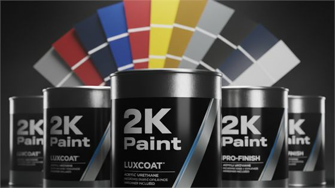

# AL-KHAN PAINTS — Bulk Order Landing Page

Premium B2B landing page for **AL-KHAN PAINTS**, a paint retailer and wholesaler in
Rawalpindi, Pakistan. Built for traffic from Facebook / Instagram advertisements, with
every conversion path routed to WhatsApp.

---

## ⚠️ REQUIRED BEFORE LAUNCH

| # | Item | Where | Status |
|---|------|-------|--------|
| 1 | **WhatsApp number** | `js/config.js` → `WHATSAPP_NUMBER` | ✅ `923498272533` — **verify on a phone before launch** |
| 2 | **Official logo** | `assets/img/logo.png` | ✅ integrated (header + footer + favicon) |
| 3 | Official brand logos | `assets/img/brands/` | ✅ 8 of 9 in place — only Crono outstanding (no authentic source) |
| 4 | Store photo | `assets/img/store-front.jpg` | ✅ in place — swap this file to change it |
| 5 | Category product photography | `assets/img/cat/` | ✅ 11 real images cropped from your own Shopify catalogue |
| 6 | **Google Maps listing** | `js/config.js` → `SITE_CONFIG.mapsUrl` | ✅ linked — button + tappable address card |
| 7 | Production URL (canonical) | `js/config.js` → `SITE_CONFIG.canonicalUrl` | `null` — tag omitted, which is honest, but set it once the domain exists |
| 8 | Real OG share photo | `assets/img/og-image.jpg` | ✅ storefront photo with navy scrim — **make the path absolute** when the domain is live |
| 9 | About identity | `index.html` → `.about__plate` | ✅ proprietor name plate (portrait removed at request) |
| 10 | Repository name | GitHub → repo settings | ⬜ must be `username.github.io`, otherwise `robots.txt` is never fetched (see Deployment) |
| 11 | `sitemap.xml` | repo root | ⬜ not created — needs absolute URLs. Template in the **SEO** section |
| 12 | Security check on the live URL | browser DevTools → Console / Network | ⬜ Console clean, and **zero** requests to any domain but your own (`node _csp.js` proves it locally) |

> **Store photo:** `assets/img/store-front.jpg` now holds the storefront photo (1600×1200,
> the shot with the signboard). The "Come See the Range Yourself" section picks it up
> automatically. To change it, just replace that file — no edits needed. If the file is
> ever missing the frame falls back to a branded navy placeholder, so the page never shows
> a broken image. Landscape works best (the frame crops to 3:2).

> **Category photography:** each of the eleven category cards shows a real product image from
> `assets/img/cat/` (560×315 JPEG, ~270 KB across all eleven). They are cropped and resized
> from the artwork on your own `alkhanpaints.com` Shopify catalogue — nothing was sourced from
> elsewhere. **Thinners is the one exception:** it is the photograph supplied directly, now
> held at `_original/thinner-ki-image.png`. The original lives there rather than in
> `assets/img/cat/` because it is 1 MB, and the card reads the 22 KB JPEG built from it.
> Replace any `.jpg` in that folder to change one; the filename is what the card points at.
> The `alt=""` is deliberate: the `<h3>` beside each image already names the category, so a
> description would be announced twice.
>
> The three images that carried a baked-in gold title (Deco, Decorative, Enamel) were cropped
> **from below that title band**, otherwise the words would sit a centimetre from the card's
> own heading. The thinner shot needed the opposite kind of care: the three cans span 560px of
> a 1024 square, so a plain centre crop would have sliced their bases off — `y=281` is the one
> window that clears both cap and base. Both decisions are written down in `_mkcats.ps1`,
> measured against the originals rather than guessed.

> **About section:** the portrait has been removed and replaced with a navy name plate reading
> **Muhammad Rasheed**. It is plain HTML text in `index.html` (`.about__plate`), so the name,
> role and address can be edited directly — no image involved.

> **Hero backdrop:** the background is a single baked image, `assets/img/hero-bg.jpg` (32 KB,
> 2400×1200). It is an abstract colour field — deep navy with a steel-blue glow upper-right and
> a warm amber hint lower-right — with the **left third deliberately darkened**. That darkened
> third is what the white headline sits on; do not brighten it without re-running the contrast
> audit. `.hero__grid` is the only live layer over it.
>
> It is regenerated with `node _genbg.js`. The blob positions and their opacities are a plain
> array at the top of that file, so nudging the composition and re-running it takes seconds.
> On phones the backdrop is biased to `24% center` plus a light veil, because a tall crop of a
> 2:1 image would otherwise pull in the brighter middle.
>
> An earlier version of this hero used the storefront photograph as a full-bleed background with
> SVG paint splashes over it. That was removed — the photo competed with the copy and the
> splashes read as clip art. If you want a photographic hero again, put it in as a *separate*
> section rather than behind the headline.

> The WhatsApp number `+92 349 8272533` has been set. Please open one CTA on a real phone
> and confirm the chat opens on the intended WhatsApp account before you start spending on ads.
>
> `assets/img/og-image.jpg` is a 1200×630 card built from the storefront photograph under a
> navy scrim, so Facebook, Instagram and WhatsApp link previews render a real image instead of
> 404-ing. Keep it at 1200×630 (JPEG, ~110 KB) if you swap it. Note that `og:image` should
> become an **absolute** URL once the production domain is known.

---

## Running it locally

There is **no build step and no `npm install`** — this project has zero dependencies.
`package.json` exists only so `npm run dev` starts a small local file server.

```bash
npm run dev
```

```
  AL-KHAN PAINTS - landing page is running

  On this computer :  http://localhost:3000
  On your phone    :  http://192.168.18.134:3000
                    (phone must be on the SAME Wi-Fi)
```

Use a different port if 3000 is taken: `PORT=8080 npm run dev`

### Three ways to test

| Method | How | Use for |
|---|---|---|
| **Local server** ⭐ | `npm run dev` | Everything — recommended |
| **Phone over Wi-Fi** | run `npm run dev`, open the printed LAN URL on your phone | Testing real mobile behaviour, WhatsApp taps |
| **Just open the file** | double-click `index.html` | Quick look. Works fine — all paths are relative. **But** on `file://` some browsers restrict features, so use the server for real testing |

> Testing on your phone matters most — the majority of Meta Ads traffic is mobile, and the
> mobile layout, sticky CTA bar and WhatsApp handoff only behave realistically on a device.

---

## Testing checklist

Work through this before going live.

**WhatsApp (most important)**
1. Tap the hero CTA on a real phone → the chat must open on the business WhatsApp account.
2. Confirm the message is pre-filled and reads correctly.
3. Repeat for: header button, one category card, bulk quote, colour matching, footer,
   floating button, and the sticky bottom bar.

**Navigation**
4. Header links scroll to the right sections (heading should not hide under the header).
5. Mobile hamburger opens, closes on link tap and on **Escape**.
6. Brand showcase centres its wrapped rows on tablet and phone.

**Layout**
7. Resize from 320px to 1920px — no horizontal scrollbar at any width.
8. Hero CTA stays above the fold (it does at 360×740 and above).

**Behaviour**
9. Scroll the whole page — no content should ever appear stuck invisible.
10. Turn on "Reduce motion" in your OS settings → all content must still be visible.
11. Keyboard only: `Tab` through the page — every focusable element needs a visible ring.

**Before launch**
12. `WHATSAPP_NUMBER` is correct and the console warning is gone.
13. Maps URL and canonical URL set once you have a domain.
14. DevTools → Network on the live URL: **every** request must be to your own domain.
    One line to any other origin means something was added that shouldn't have been.
15. DevTools → Console on the live URL: clean, with no CSP refusal and no404.

### Automated checks

The dev scripts below re-run the checks that matter after any edit. All need
Chrome installed; all are **dev-only** and are never uploaded.

| Command | Verifies |
|---|---|
| `node _final.js` | 11 viewports (320→1920): no horizontal scroll and CTA above the fold; 11 categories; 9 brands (8 with real logo files); all 20 WhatsApp CTAs resolving to `WHATSAPP_NUMBER`; no broken anchors, no missing `alt`, valid JSON-LD; store-photo fallback engaged |
| `node _contrast.js` | WCAG AA contrast at **desktop** (1440×900) |
| `node _contrast.js 390 844` | WCAG AA contrast at a **phone** viewport |
| `node _shot.js 1440 900 .hero,#products` | Screenshots any viewport + list of selectors into `%TEMP%\opencode\alpaints\`, for eyeballing a change |
| `node _csp.js` | The shipped Content-Security-Policy is enforced **and harmless** — both self-hosted fonts resolve, the JSON-LD block survives, the eight swatch chips still paint, Chrome reports no CSP violations, and zero requests leave the origin |

> `_csp.js` is the only script that runs with CSP **on**. The others call
> `Security.setBypassCSP` because they inject a `<style>` tag, which the policy
> (correctly) blocks. A policy that is only ever tested with itself switched off
> has not been tested — and it caught two real breakages on its first run: the
> swatch chips' inline `style=""` attributes, and the missing Crono image.

> `_contrast.js` samples the *actual rendered pixels* of a screenshot rather than
> reading `getComputedStyle`, because a CSS-only audit cannot see gradient
> backgrounds and reports false failures. It also skips `.sr-only` spans and the
> skip-link — those are deliberately never painted, so contrast does not apply to
> them. Any element it cannot score is listed by name rather than silently passed.

> `_shot.js` uses the same CDP route as the other two. Its wait for page images is
> *bounded per image*: `store-front.jpg` and the eleven category images are
> `loading="lazy"` and never load while off-screen, so an unbounded "wait for all
> images" would hang forever. It also forces `scroll-behavior: auto` before each
> jump — the page scrolls smoothly, and a screenshot taken mid-flight lands between
> two sections.

---

## Project structure

```
alkhan_landingpage/
├── index.html              # Semantic page markup (all content lives here)
├── css/
│   ├── fonts.css           # GENERATED by _getfonts.js — self-hosted @font-face
│   └── styles.css          # Design system + responsive rules
├── js/
│   ├── config.js           # ★ SINGLE SOURCE OF TRUTH — number, address, maps, messages
│   └── main.js             # Navigation, reveal motion, CTA wiring
├── assets/
│   ├── favicon-32.png      # Browser tab icon
│   ├── favicon-180.png     # iOS home-screen icon
│   ├── favicon-512.png     # PWA / large icon
│   ├── favicon.svg         # Monogram fallback (used as a mask icon)
│   ├── fonts/              # Inter + Plus Jakarta Sans .woff2 — built by _getfonts.js
│   └── img/
│       ├── logo.png        # Official logo, transparent, cropped — header/footer
│       ├── logo-header.png # Car + wordmark only (tagline dropped) for the header
│       ├── hero-bg.jpg     # Hero backdrop — generated by _genbg.js, 2400×1200
│       ├── store-front.jpg # Storefront photo — "Come See the Range Yourself" section
│       ├── og-image.jpg    # 1200×630 social share card (storefront photo)
│       ├── cat/            # 11 category card photos (560×315) — built by _mkcats.ps1
│       └── brands/         # ← drop official brand logos here
├── robots.txt              # Crawler policy. Host-root only — read the note inside.
├── _headers                # Response headers for Netlify / Cloudflare Pages
├── _config.yml             # Jekyll excludes — keeps dev files off the published site
├── .gitignore              # Keeps _original/ and node_modules/ out of the repo
│
│   # Everything below is development-only and is never published. The `_`
│   # prefix is what does that: GitHub Pages runs Jekyll, and Jekyll drops
│   # every path starting with an underscore from its output.
│
├── server.js               # Local dev server (zero deps) — used by `npm run dev`
├── package.json            # Only provides the `npm run dev` script. No dependencies.
├── _final.js               # Dev-only: layout + integrity regression suite (`node _final.js`)
├── _contrast.js            # Dev-only: pixel-based WCAG AA contrast audit
├── _shot.js                # Dev-only: CDP screenshots for eyeballing a change
├── _csp.js                 # Dev-only: proves the CSP is enforced and harmless
├── _genbg.js               # Dev-only: regenerates the hero backdrop (`node _genbg.js`)
├── _getcats.js             # Dev-only: pulls the category artwork from alkhanpaints.com
├── _mkcats.ps1             # Dev-only: crops/resizes it into assets/img/cat/*.jpg
├── _getfonts.js            # Dev-only: self-hosts the fonts (`node _getfonts.js`)
├── _probe.js               # Dev-only: lists the CDP method names this Chrome exposes
├── _original/              # Untouched source artwork — gitignored, never published
└── README.md
```

**No build step, no framework, no dependencies.** `npm install` is not needed — there is
nothing to install. Upload the folder to any static host (Netlify, Vercel, Cloudflare
Pages, GitHub Pages, cPanel, Hostinger).

---

## Configuration

Everything editable lives in **`js/config.js`**.

### WhatsApp

```js
const WHATSAPP_NUMBER = "923498272533";   // +92 349 8272533
```

* Digits only — country code first, **no** `+`, spaces or dashes.
* Pakistan: `92` + number, e.g. `923001234567`.
* Every WhatsApp button on the page (hero, header, 12 category cards, bulk orders,
  colour matching, contact, final CTA, floating button, mobile sticky bar, footer)
  is generated from this one value.

### Pre-filled messages

`WHATSAPP_MESSAGES` maps a key to a message. To add a new CTA, add a key and reference it
from HTML — no other file changes:

```js
WHATSAPP_MESSAGES["my-new-cta"] = "Assalam-o-Alaikum AL-KHAN PAINTS, ...";

// index.html
<a href="#" data-wa="my-new-cta">...</a>
```

### Maps & canonical URL

```js
mapsUrl: "https://www.google.com/maps/place/AL-Khan+Paints/@33.6324375,73.0681875,17z/data=...",
geo: { latitude: 33.6324375, longitude: 73.0681875 },
canonicalUrl: null,     // set the production URL → <link rel="canonical"> is injected
```

The verified Google Maps listing is already set. When `mapsUrl` is present the page shows
a **Get Directions** button and a tappable address card, and adds `geo` + `hasMap` to the
schema.org data. Set `canonicalUrl` once you have a domain.

### Brand logos

Official artwork lives in **`assets/img/brands/`**. **Four of five are already in
place and rendering live:**

| File | Brand | Status |
|---|---|---|
| `nippon-paints.svg` | Nippon Paints | ✅ official SVG (nipponpaint.com.pk) |
| `master-paints.png` | Master Paints | ✅ official artwork, tight-cropped |
| `kaizen-paints.png` | Kaizen Paints | ✅ official full lockup, transparent |
| `mixtone.png` | Mixtone | ✅ official wordmark, cropped from brand banner |
| `berger-paints.png` | Berger Paints | ✅ official artwork, trimmed + keyed to white |
| `crono-paints.png` | Crono Paints | ⬜ **no authentic source exists** — ships as a designed wordmark, with no `` so nothing404s |
| `ici-paints.png` | ICI Paints | ✅ official emblem, off-white ground keyed to white |
| `cartec.png` | Cartec | ✅ official mark — blue ground is part of the trademark, kept |
| `voylet.png` | Voylet | ✅ official wordmark, trimmed; stray cut-off fragment removed |

Berger, ICI, Cartec and Voylet come from the brand collection images on
`alkhanpaints.com`. ICI and Voylet sat on an off-white `#F7F7F7` ground that showed a faint
box against the white tile, so the background was keyed to pure white; both plus Berger were
trimmed to their actual bounding box, since the tile scales by height and any whitespace
margin makes a logo render visibly smaller than its neighbours. Cartec's blue ground **was
not** removed — it is part of the mark, and stripping it would leave white lettering on a
transparent tile.

Crono has no brand website, and every Crono image on `alkhanpaints.com` is a
product or marketing shot rather than standalone logo artwork. Rather than redraw
a trademark, the tile ships as the designed typographic wordmark — and its ``
tag is *absent*, not merely missing its file. An `` pointing at something that
does not exist404s on every page load, which is crawl noise and a console error,
so the tag itself was removed. The exact markup to re-add is in the comment above
the Crono tile in `index.html`.

The page detects each file automatically — if present the real logo is shown, if
missing a clean typographic wordmark is used instead. **You can swap them one at a
time; nothing breaks while a file is absent.**

**Keep logos tight-cropped with no whitespace border.** The tile scales by height
to a fixed 46px, so a logo with big empty margins renders visibly tiny.

Use official artwork from each brand's own website or their authorised
representative. Do not redraw or approximate a logo — recreated marks get colours,
proportions or lettering wrong, and the brand may ask you to remove it.

> **Gotcha:** brand logo `` tags must **not** carry `loading="lazy"`. They start
> `display:none` (the typographic fallback is what you see first), and a lazy image
> with no layout box never intersects the viewport — so it never loads, never fires
> `load`, and `.is-ok` is never added. That is a permanent deadlock, not a slow load.

### Analytics

No third-party tracking script is bundled. Every CTA click pushes an event onto
`window.dataLayer` (Google Tag Manager's convention). To connect an analytics tool,
either add your GTM snippet to `<head>` or replace the `track()` function in `config.js`.
**Add a consent banner before enabling analytics on a live site.**

---

## Swapping in real assets

### Hero photography

The hero visual is currently the "What we supply" range board. If you later get a strong
product shot, replace the whole `<div class="hero__visual">` block in `index.html`:

```html
<figure class="hero__media">
  
</figure>
```

Always set `width`/`height` to prevent layout shift, and keep `fetchpriority="high"`.
Export as **WebP** (fallback `<picture>` with AVIF/JPEG if needed).

### Category card imagery

Every `.cat-card__media` already holds a real photograph — this is about swapping them, not
adding them. The markup is:

```html
<figure class="cat-card__media">
  
</figure>
```

On desktop the band runs full-bleed across the card at 16:9; the card carries
`overflow: hidden`, which clips it to the rounded corners. At ≤620px the same image becomes a
left-hand thumbnail inside a list row rather than a stacked band — see the note in
`styles.css`, which records why that trade was made.

To rebuild all eleven from the source artwork:

1. `node _getcats.js` — pulls the collection and product images from `alkhanpaints.com` into
   `%TEMP%\opencode\alpaints\cats\`
2. `powershell -ExecutionPolicy Bypass -File _mkcats.ps1` — crops, resizes and writes
   `assets/img/cat/*.jpg`

`_getcats.js` only fills the Shopify-sourced sources; the thinner shot is read straight from
`_original/`. To wire in a photo supplied later, drop it in `_original/` and add one line to
the `$Jobs` table in `_mkcats.ps1` — `dir` to point at it, plus `box = @(x, y, w, h)` when
the crop that frames the subject isn't the centred one.

**Keep `width` and `height` on every image.** They are what reserves the box before the lazy
image arrives, so nothing below it shifts.

### Brand logos

**Do not recreate or approximate official logos.** Obtain the real artwork from each
brand's own website or their authorised representative, save to `assets/img/brands/`,
then point the tile's `` at it. The file already carries `class="brand-tile__logo"`:

```html

```

Note the **absence of `loading="lazy"`** — see the gotcha under *Configuration → Brand
logos* above; adding it silently breaks detection. Keep the typographic
`.brand-tile__word` in place as the accessible fallback, and preserve the logo's
original colours, proportions and spelling.

---

## Business-information accuracy

The page deliberately makes **no claims that were not provided**. Specifically, it does
**not** claim:

* discounts, prices or minimum order quantities
* guaranteed stock, delivery coverage or turnaround times
* exclusive dealership, official partnership or authorised-dealer status
* customer counts, ratings, reviews, awards or certifications
* "Pakistan's No. 1" or similar superlatives
* that AL-KHAN PAINTS manufactures its own paint
* a separate "Automotive Paints" category — **2K Paints is the automotive/refinishing
  range**, so it is covered there. The car in the logo makes the specialisation obvious
  without needing a redundant category name.

Brand names appear only to identify the brands whose products are supplied; a disclaimer
covers this in the brand section and the footer.

### Stated policy: no loan / credit

The owner confirmed: **AL-KHAN PAINTS does not deal on loan or credit.** This is stated
in two places:

* a **Payment & order terms** note in the Bulk Orders section (with a Roman-Urdu
  line — *"Hum loan par deal nahi karte."* — for local buyers)
* a **Payment terms** row in the Contact → Store Details card

Placing it up front means buyers who cannot pay on settlement self-select out before
enquiring, so your team isn't fielding credit requests on WhatsApp. If this policy ever
changes, edit the `.terms-note` block in `index.html` and the `detail-list` row.

If any of the other items above becomes true and verifiable, add it — but only then.

---

## Accessibility

* Semantic landmarks (`header` / `nav` / `main` / `section` / `footer`) and a skip link
* Correct heading hierarchy — one `<h1>`, ordered `<h2>`/`<h3>`
* Visible `:focus-visible` rings; mobile menu traps focus and closes on `Escape`
* WCAG AA contrast verified across all text/background pairs on the page (0 failures)
* Decorative SVGs are `aria-hidden`; the hero illustration has a descriptive label
* Touch targets ≥ 48px throughout
* Full `prefers-reduced-motion` support — reveals and animations are disabled
* Primary CTA sits above the fold at every common viewport tested, 360×740 → 1920×1080

## Performance

* Zero dependencies, zero build step — HTML + two CSS files + two small JS files
* **No third-party requests at all.** Fonts are self-hosted in `assets/fonts/`
  (178 KB of .woff2 on disk; a browser downloads only the ~74 KB latin subset it
  needs). `_csp.js` asserts the third-party count stays at zero.
* Above the fold the only raster is the 32 KB hero backdrop, preloaded because it
  is the LCP element; everything else raster (category photos, store photo, brand
  logos) is either lazy-loaded or below the fold
* Category and store images carry `width`/`height`, so nothing reflows when they arrive
* Font loaded non-blocking with `preconnect` and a system-font fallback stack
* Reveal animations are one-shot `IntersectionObserver`, throttled with `requestAnimationFrame`
* Scroll listeners are passive and rAF-throttled
* `overflow-x: hidden` guard plus no fixed-width elements — no horizontal overflow

## Browser support

Modern evergreen browsers (Chrome, Edge, Safari, Firefox, Android WebView, iOS Safari).
Uses `clamp()`, CSS grid, custom properties, `IntersectionObserver` and `backdrop-filter`.

---

## Customising the design system

All colours, radii, shadows and spacing live in `:root` at the top of `css/styles.css`:

```css
:root {
  --navy-800: #0b1f3a;   /* primary dark */
  --royal:    #174a8b;   /* accent / CTAs */
  --soft:     #f6f8fb;   /* section background */
  --muted:    #5f6e81;   /* secondary text — see note below */
  --radius:   16px;
}
```

**One deliberate deviation from the brief.** The spec called for `--muted: #64748B`. Measured
against the `#F6F8FB` soft-white surface that lands at **4.47:1**, just under the WCAG AA
4.5:1 requirement, and it is used for body copy across four sections. The token is
therefore darkened one step to **`#5F6E81`**, which reaches 4.89:1 on soft-white and
5.2:1 on white while keeping the same muted blue-grey character. Every other palette
value is exactly as specified. All other colour pairs on the page pass AA.

Fonts are set with `Plus Jakarta Sans` (display) and `Inter` (body), both loaded from
Google Fonts with system fallbacks. To go fully self-hosted, download the `.woff2` files
into `assets/fonts/`, drop the two `<link>` tags in `<head>`, and add a matching
`@font-face` block.

---

## Design decisions (read before editing)

This page was deliberately pushed away from the generic landing-page look. Eight moves do
that work — each is the kind of thing a later "tidy up" would quietly revert.

1. **The hero card is a colour-match card, not an icon grid.** It originally listed
   Hardeners / 2K / Enamel / Deco … in eight tiles — the exact block every page builder
   emits, and the same list already sitting in the section directly below it. One claim
   about colour matching plus eight swatch chips is specific to a paint trade: no other
   trade could put that block on their page. The chips deliberately carry **no names or
   codes** — inventing colour names would be fabricated data. The comment above the card
   shows the swap if real product photography arrives.

2. **Eyebrows use a rule, not a dot.** `● UPPERCASE — WIDE-TRACKED` is the most
   recognisable template marker there is. `.eyebrow::before` draws a 1.75rem hairline
   instead, and letter-spacing was tightened from `0.14em` to `0.1em`.

3. **Section heads are left-aligned to a fixed 40rem measure.** Centring every section
   head identically down a long page is what makes a layout read as generated. Left rag
   reads as editorial. `.final-cta` stays centred on purpose — it is the one full-bleed
   closing statement.

4. **The hero runs on `align-items: start`, not `center`.** Two centred halves is the
   safest possible composition. Top-aligned, both columns share a rail and the lit
   lower-right of the backdrop is left open for the copy column to run long.

5. **The trust row uses countable figures** — `40+ / 9 / 11 / Bulk`. `_final.js` asserts
   11 category cards and 9 brand tiles, so the two numbers that *can* drift are checked
   on every run. "Expert / Wholesale / Multiple" was the previous wording and proved
   nothing.

6. **Category cards carry real product photography, not icons.** Each card held an inline
   SVG glyph in a navy rounded square — the universal page-builder card. All eleven now
   show a real product image cropped from your own `alkhanpaints.com` catalogue. Nothing
   was bought or taken from a stock library, and no trademark was redrawn. Three source
   images had their own title baked into the artwork; those crops are recorded in
   `_mkcats.ps1` rather than left to be re-derived by eye.

7. **The desktop container steps up to 1560px at ≥1440px.** At `1280px` a 1920 monitor left
   360px of dead margin on each side, which is what "why is there empty space on desktop?"
   was about. Widening the container is *not* a one-line change: `.brand-tile` has to move
   with it. Flex resolves wrapped rows from the basis, and six tiles at 200px plus gaps
   fits inside a 1480px content area — the grid would silently collapse from 5 + 4 into
   6 + 3. The basis therefore goes 200 → 240 in the same media query, and the hero columns
   get more unequal plus a wider copy measure so the left column does not open a dead gap
   beside the colour-match card. These are one decision; change the number, change them all.

8. **The mobile category row stays a row.** A full-bleed band per card was built here and
   reverted: eleven of them add roughly 1700px of scrolling on a page that is already long,
   which is the wrong trade for ad traffic. What changed is the media column — it scales
   with the viewport instead of being the fixed 50px box that was sized for an icon, since
   50px smears a product photograph.

---

## Security

This is a static page with **no backend, no database, no forms and no user input**.
There is nothing to log in to, nothing to SQL-inject, nothing to upload through. The
threats that actually apply to a page like this are different ones:

| Threat | What it looks like | Defence here |
|---|---|---|
| **Injected script** | Someone gets into the host account — a bad FTP client, a nulled plugin, a phishing email — and inserts `<script src="https://…malware…">` into `index.html`. This is overwhelmingly the most common way small business sites get compromised and flagged as unsafe. | **Content-Security-Policy**: `script-src 'self'` makes the visitor's browser refuse that tag before it runs. The page has no inline scripts and no inline event handlers, so no `'unsafe-inline'` is needed anywhere. |
| **Supply chain** | A third-party origin — a font CDN, an analytics snippet, a chat widget — is compromised or starts serving malware to your visitors. | **Zero third-party requests.** Fonts are self-hosted in `assets/fonts/`. `_csp.js` asserts the count is zero on every run. |
| **Clickjacking** | Another page frames yours and tricks a visitor into clicking something they cannot see. | `frame-ancestors 'none'` + `X-Frame-Options: DENY`. GitHub Pages cannot set either — see the caveat below. |
| **MIME sniffing** | A file served as text is sniffed and executed as script. | `X-Content-Type-Options: nosniff`, `object-src 'none'`. |
| **Downgrade / MITM** | A visitor reaches the HTTP version and is intercepted. | `upgrade-insecure-requests` in the CSP, `Strict-Transport-Security` in `_headers`. |
| **CSS exfiltration** | Injected `<style>` rules read attribute values and leak them out. | `style-src 'self'` — inline styles are refused. |

**Where the policy lives.** GitHub Pages gives you no way to set response headers, so
the Content-Security-Policy ships as a `<meta http-equiv>` tag in `index.html`, which
every host honours. `_headers` carries the same policy *plus* `frame-ancestors` for
Netlify and Cloudflare Pages — move hosts later and it takes over with no edits. Keep
the two in step with each other.

**Two things the policy cost, both already paid.** The eight hero swatch chips used to
carry their colours as `style="--sw:…"` attributes; those are inline styles, so they
moved into `styles.css` as `.swatches__chip--1 … --8`. The Crono brand tile pointed at
a `crono-paints.png` that does not exist — a404 on every page load — so its `` was
removed rather than left to fail. Both are exactly the kind of breakage a CSP turns up,
and both are why `_csp.js` runs with the policy switched **on** while every other dev
script bypasses it.

**Never add:** `'unsafe-inline'` anywhere in the policy, an external `<script>`, a chat
widget, an ad-platform tracking pixel, or an analytics snippet without a consent
banner. Each one either undoes the CSP or punches a hole in it.

**The local dev server** (`server.js`) rejects `../` path traversal, answers400 on
malformed URLs, and is excluded from the published site. It is not a production server
and is never uploaded.

---

## SEO

One URL, so there is no crawl-depth problem and no duplicate-content problem. What
matters is that it is unambiguous about what and where the business is.

**Asserted by `_final.js` on every run:** exactly one `<h1>`; ordered `h2`/`h3`;
every image carries `alt` (decorative ones deliberately `alt=""`); valid JSON-LD
(`Store`, with the verified street address and the geo coordinates from the Maps
listing); no broken anchors; no `loading="lazy"` on brand logos, which would leave
them permanently invisible.

**In the head:** a title and description that name both the city and the real product
range, `lang="en"`, `robots: index, follow`, full Open Graph and Twitter card tags,
and `theme-color` for the Android address bar.

**Speed counts as ranking.** Above the fold there is one 32 KB raster, preloaded
because it is the LCP element; every image reserves its box with `width`/`height` so
nothing shifts; fonts are self-hosted, which removes a DNS lookup, a TLS handshake
and a redirect from first paint, and works even where `fonts.gstatic.com` is slow.

**Outstanding, and all of it needs the live domain:**

| Item | Where |
|---|---|
| `SITE_CONFIG.canonicalUrl` | `js/config.js` — currently `null`, so the tag is omitted rather than wrong |
| Absolute `og:image` / `twitter:image` | `index.html` — relative paths work for some scrapers and not for Facebook |
| `sitemap.xml` | Needs absolute URLs. Ready-to-use template below |

Drop this in as `sitemap.xml` once the domain exists, replacing `YOUR-DOMAIN`:

```xml
<?xml version="1.0" encoding="UTF-8"?>
<urlset xmlns="http://www.sitemaps.org/schemas/sitemap/0.9">
  <url>
    <loc>https://YOUR-DOMAIN/</loc>
    <changefreq>monthly</changefreq>
    <priority>1.0</priority>
  </url>
</urlset>
```

A one-page site does not strictly need a sitemap — Google will find a single URL on
its own — but it costs nothing, and it is where any future page gets listed.

**Do not** chase keyword-stuffed titles, invented reviews, or a second page of thin
content. The strongest ranking signal for "paint supplier in Rawalpindi" available
here is a fast, accessible, honestly-described page plus the verified Google Maps
listing already linked from it.

---

## Deployment

### GitHub Pages

1. Push the folder to a repository named **`username.github.io`**. This matters: that
   is the only kind of repository served at the *host root*, and the host root is the
   only place Google reads `robots.txt` from. In a project repository
   (`username.github.io/repo/`) the file is fetched by nobody — delete it rather than
   ship one that never answers.
2. **`_original/` is in `.gitignore` on purpose.** A free Pages site can only be
   served from a public repository, so anything committed is readable by anyone —
   including the unedited owner portrait and the original brand artwork.
3. **Do not add `.nojekyll`.** Jekyll drops every path beginning with `_` from its
   output, which is what keeps the eight dev scripts out of the live site.
   `_config.yml` additionally excludes `server.js`, `package.json` and `README.md`.
4. Settings → Pages → deploy from the main branch. No build command; the folder *is*
   the site.

**One limitation worth knowing:** GitHub Pages gives no control over response headers,
so `X-Frame-Options`, `X-Content-Type-Options` and HSTS cannot be set there. The CSP
still applies through its `<meta>` tag, which is the defence that matters most. Moving
the same files to Netlify or Cloudflare Pages later restores all of them with no edits.

### Any other static host

Upload `index.html`, `css/`, `js/`, `assets/` and `robots.txt`. `_headers` is picked up
automatically by Netlify and Cloudflare Pages. Leave `_original/` behind — it holds the
untouched source artwork (the uploaded logo, the owner portrait, the cover banner and
the raw brand-logo files) and is not part of the site.

**Post-deploy checklist**

1. `WHATSAPP_NUMBER` in `js/config.js` is correct and the console warning is gone.
2. Tap every WhatsApp CTA on a real phone; each must open on the business account with
   the right pre-filled text.
3. Set `SITE_CONFIG.canonicalUrl`, make `og:image` absolute, add `sitemap.xml`.
4. Confirm `og-image.jpg` renders as the link preview.
5. Open the live URL, then DevTools → Console must be clean, and Network must show
   **no** request to any domain other than your own.
6. Test on a real phone — most traffic is mobile.
7. Paste the live URL into Meta Ads so link previews render.

---

*No claims on this page are fabricated. Every capability described was supplied as
business information and is limited to what is stated.*